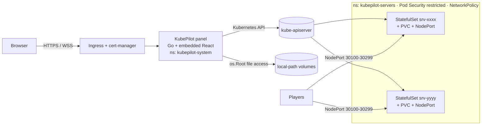

<p align="center">
  
</p>

<p align="center">
  <a href="https://github.com/NycolazSec/KubePilot-Panel/actions/workflows/ci.yml"></a>
  
  <a href="LICENSE"></a>
  
  
</p>

**KubePilot** is an open-source, Kubernetes-native game server panel — an alternative to Pterodactyl.
There is no Wings daemon and no Docker socket: **every game server is a Kubernetes `StatefulSet`** with its own
volume and `NodePort` service, and the panel drives the cluster through the Kubernetes API.

> The interface is available in **English** and **French** — [add your language](CONTRIBUTING.md#translations)! Companion project: the [KubePilot Discord bot](https://github.com/NycolazSec/KubePilot).

## Features

| For players & server owners | For admins |
|---|---|
| Live dashboard: status, CPU, RAM, disk, one-click address copy | Cluster overview: nodes, CPU/RAM usage, ports, disk, backups |
| Real-time console over WebSocket (ANSI colors, command history, search, log export) | Create servers from templates (owner, resources, variables, auto-start) |
| Start / restart / stop / kill, crash detection (OOMKilled, exit codes, image errors) | Edit resources, image, startup command, suspend servers |
| File manager: CodeMirror editor, drag & drop upload, zip download, archive / extract | Users & roles, two-factor authentication (TOTP + recovery codes), editable templates with JSON import/export |
| Backups: create, restore, download, lock, automatic rotation | Settings: panel name, public address, port range, timezone |
| Cron schedules: commands, power actions, backups | Global activity log |
| Validated startup variables, image selection, extra ports, sub-users with fine-grained permissions |
| **Plugins & mods** from Modrinth: compatible results only, one-click install with dependencies, updates | |
| **Minecraft router**: each server at `survival.mc.example.com`, standard port, no port to type | |
| **Minecraft panel**: live status (MOTD, version, icon), online players with their skin heads, whitelist / ops / bans in one click (RCON) | |
| **REST API** with personal API keys (permissions, read-only, IP allow-list, expiry): control servers from scripts and bots — see [docs/API.md](docs/API.md) | |

Built-in templates: **Minecraft Java** (Paper, Purpur, Vanilla, Fabric, Forge, NeoForge… via `itzg/minecraft-server`),
**Minecraft Bedrock**, **Node.js** and **Python** (Discord bots & apps, optional Git clone + `npm`/`pip` install),
and **custom Docker image**.

## How it works



| Panel action | Kubernetes |
|---|---|
| Create server | `PersistentVolumeClaim` + `Service` (NodePort) + install `Job` |
| Start / stop | apply `StatefulSet` with `replicas: 1` / `0` (graceful `SIGTERM`) |
| Console output | pod logs, streamed and buffered by the panel |
| Console input | `pods/attach` to the container's stdin |
| CPU / RAM | `metrics.k8s.io` |
| Files, backups | the volume's directory on the node, opened with Go's traversal-safe `os.Root` |

## Security

- **Game pods**: namespace enforced at Pod Security `restricted` — UID 1000, all capabilities dropped, no privilege escalation, seccomp `RuntimeDefault`, no service-account token.
- **Network isolation**: a `NetworkPolicy` gives game servers Internet + DNS access but blocks private ranges, the cluster network and the node IPs (databases, API server…).
- **Least privilege**: the panel's ServiceAccount has full rights *only* in `kubepilot-servers`, and read-only access to nodes, PVs, services and metrics. No access to Secrets.
- **Storage isolation**: game volumes live in their own folder (dedicated `kubepilot-local` StorageClass) and the panel only mounts that folder — it never sees the volumes of the other applications of the cluster.
- **Origin lock** (optional, Traefik): with `ingress.cloudflareOnly`, the panel only answers requests coming from Cloudflare, so its protections can't be bypassed by hitting the node's IP.
- **File manager**: every path goes through `os.Root`, so even a symlink planted by a game server can't escape its volume; FIFOs and devices are refused, archives are checked for size and entry count (zip bombs, zip slip).
- **Disk quotas**: uploads, archives and the editor stop at each server's limit, and a running server that writes far beyond it is stopped, so no server can fill the node's disk.
- **Auth**: bcrypt (cost 12), TOTP two-factor authentication with single-use recovery codes (can be made mandatory for admins or everyone), hashed session tokens in a `__Host-` `HttpOnly` `Secure` `SameSite=Lax` cookie, mandatory anti-CSRF header, WebSocket origin check, sign-in limits per IP and per account, strict CSP, HSTS, activity log.

## Requirements

- A Kubernetes cluster (≥ 1.29) — developed on **k3s**, which ships everything below except cert-manager
- A hostPath-based storage provisioner for game volumes: `local-path` (built into k3s, or
  [local-path-provisioner](https://github.com/rancher/local-path-provisioner) elsewhere)
- [metrics-server](https://github.com/kubernetes-sigs/metrics-server), an ingress controller and
  [cert-manager](https://cert-manager.io) with a `ClusterIssuer` for HTTPS

## Getting started

KubePilot is installed with Helm. Images are published for `amd64` and `arm64` on every release.

```sh
helm install kubepilot oci://ghcr.io/nycolazsec/charts/kubepilot \
  --namespace kubepilot-system --create-namespace \
  --set ingress.host=panel.example.com \
  --set ingress.clusterIssuer=letsencrypt-prod

# create the first admin account
kubectl -n kubepilot-system exec deploy/kubepilot -- \
  kubepilot user:create --username admin --email you@example.com --password 'change-me-please' --admin
```

Then point a DNS record for your domain at the cluster and open `https://<your domain>`.
A user who lost both their phone and their recovery codes can have two-factor authentication reset by an admin in
*Users*, or with `kubectl -n kubepilot-system exec deploy/kubepilot -- kubepilot user:2fa-reset --username <name>`.
Players connect to `<node address>:<port>`; game ports are NodePorts in `30100-30299` (configurable in the admin
settings, within `30000-32767`). Open that range (TCP + UDP) if a firewall sits in front of the node.

All chart options (storage, node, ingress, resources…) are documented in the [chart README](charts/kubepilot/README.md).
Upgrade with `helm upgrade kubepilot oci://ghcr.io/nycolazsec/charts/kubepilot -n kubepilot-system --reuse-values`.

## Development

```sh
./build.sh                         # typecheck + build the frontend, go vet, build ./kubepilot
./kubepilot -data ./dev-data -listen 127.0.0.1:8099 -secure-cookies=false \
  -kubeconfig ~/.kube/config       # run locally against your cluster
cd frontend && npm run dev         # Vite dev server, proxies /api to 127.0.0.1:8099
./deploy.sh                        # k3s: build the image from source and deploy it with the chart (deploy/config.env)
```

```
backend/    Go: HTTP API, auth, Kubernetes driver (client-go), console hub, files, backups, schedules
frontend/   React + TypeScript + Tailwind, xterm.js console, CodeMirror editor
charts/     Helm chart
deploy/     config example for ./deploy.sh
docs/       logo and banner
```

## Notes & limitations

- The file manager and backups read `local-path` volumes directly, so the panel is pinned to the node that holds
  them (`storage.node`). Multi-node storage would need a CSI driver with a file API.
- Java heap is set to the memory limit minus max(640 MB, 20 %) to avoid OOM kills; templates get it as `SERVER_JVM_MEMORY`.
- Disk limits are soft: usage is measured by the panel and a server over its quota can't be started.

## Roadmap

Coming next: Pterodactyl egg import, SFTP, MySQL databases and S3 backups (v0.2), then multi-node, server transfers and
auto-sleep (v0.3).
See the full [roadmap](ROADMAP.md).

## Contributing

Contributions are welcome — read the [contributing guide](CONTRIBUTING.md) to get started.
Found a security issue? Please follow the [security policy](SECURITY.md) and report it privately.

## License

KubePilot is free software, licensed under the [GNU Affero General Public License v3.0](LICENSE).
You can use, modify and host it, but if you offer a modified version to users over a network, you must publish your
source code under the same license.
