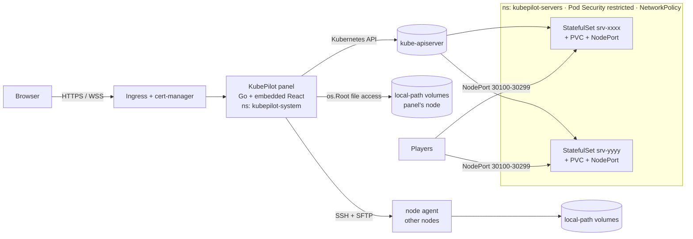

<p align="center">
  
</p>

<p align="center">
  <a href="https://github.com/NycolazSec/KubePilot-Panel/actions/workflows/ci.yml"></a>
  
  <a href="LICENSE"></a>
  
  
</p>

**KubePilot** is an open-source, Kubernetes-native game server panel — an alternative to Pterodactyl.
There is no Wings daemon and no Docker socket: **every game server is a Kubernetes `StatefulSet`** with its own
volume and `NodePort` service, and the panel drives the cluster through the Kubernetes API.

> The interface is available in **English** and **French** — [add your language](CONTRIBUTING.md#translations)! Companion project: the [KubePilot Discord bot](https://github.com/NycolazSec/KubePilot).

## Features

| For players & server owners | For admins |
|---|---|
| Live dashboard: status, CPU, RAM, disk, one-click address copy | Cluster overview: nodes, CPU/RAM usage, ports, disk, backups |
| | **Several machines**: add one with two commands, new servers go where there is room (or where you choose), each machine with its own public address |
| | **Standard game ports** (optional): 25565, 19132, 27015… instead of 30100-30299, from a pool you define — the same port can serve one server on each machine |
| | **Prometheus metrics** and a **Grafana dashboard**: servers (state, CPU, memory, disk, players, restarts), machines, ports, firewall |
| Real-time console over WebSocket (ANSI colors, command history, search, log export) | Create servers from templates (owner, resources, variables, auto-start) |
| Start / restart / stop / kill, crash detection (OOMKilled, exit codes, image errors) | Edit resources, image, startup command, suspend servers |
| File manager: CodeMirror editor, drag & drop upload, zip download, archive / extract | Users & roles, two-factor authentication (TOTP + recovery codes), password reset by email, editable templates with JSON import/export |
| | **Pterodactyl / Pelican eggs**: import from a catalog of ~300 games and apps, a link or a file |
| Backups: create, restore, download, lock, automatic rotation — on the panel's volume or **S3** (optionally encrypted) | Settings: panel name, public address, port range, timezone |
| Cron schedules: commands, power actions, backups | Global activity log |
| **Firewall** per server: block addresses, or only let some in | **Anti-DDoS** (optional): limits per source IP on the game ports, automatic bans, "under attack" mode, packets dropped by reason, bans and global rules in *Admin* → *Firewall* |
| Validated startup variables, image selection, extra ports, sub-users with fine-grained permissions |
| **Plugins & mods** from Modrinth: compatible results only, one-click install with dependencies, updates | |
| **Minecraft router**: each server at `survival.mc.example.com`, standard port, no port to type | |
| **Auto-sleep**: empty servers stop by themselves and start again as soon as a player joins — RAM and CPU only for the servers people play on | |
| **Minecraft panel**: live status (MOTD, version, icon), online players with their skin heads, whitelist / ops / bans in one click (RCON) | |
| **Databases**: MySQL / MariaDB per server in one click, credentials and JDBC URL to copy | |
| **SFTP** (FileZilla, WinSCP…) with your panel password or SSH keys, sub-user permission, quota-aware | |
| **REST API** with personal API keys (permissions, read-only, IP allow-list, expiry): control servers from scripts and bots — see [docs/API.md](docs/API.md) | |

Built-in templates: **Minecraft Java** (Paper, Purpur, Vanilla, Fabric, Forge, NeoForge… via `itzg/minecraft-server`),
**Minecraft Bedrock**, **Node.js** and **Python** (Discord bots & apps, optional Git clone + `npm`/`pip` install),
and **custom Docker image**.

## How it works



| Panel action | Kubernetes |
|---|---|
| Create server | `PersistentVolumeClaim` + `Service` (NodePort) + install `Job` |
| Start / stop | apply `StatefulSet` with `replicas: 1` / `0` (graceful `SIGTERM`) |
| Console output | pod logs, streamed and buffered by the panel |
| Console input | `pods/attach` to the container's stdin |
| CPU / RAM | `metrics.k8s.io` |
| Files, backups | the volume's directory on the node, opened with Go's traversal-safe `os.Root` — directly on the panel's node, through that node's agent on the others |
| Several machines | each server is pinned to its node (node affinity); `NodePort` with `externalTrafficPolicy: Local`, so players use that node's address |
| Standard ports | the firewall agent of the server's node forwards the port to its pod (nftables DNAT, players' addresses kept); game pods stay Pod Security `restricted` (no `hostPort`) |

## Security

- **Game pods**: UID 1000, all capabilities dropped, no privilege escalation, seccomp `RuntimeDefault`, no service-account token (Pod Security `restricted`). Only the install scripts of eggs run as root, still without privilege escalation and with a minimal set of capabilities; the namespace is then enforced at `baseline` with `restricted` audited (`serversNamespace.rootInstall=false` enforces `restricted`).
- **Network isolation**: a `NetworkPolicy` gives game servers Internet + DNS access but blocks private ranges, the cluster network and the node IPs (databases, API server…). The one opening is the ingress controller's HTTP/HTTPS entry points, so a server can reach the websites the cluster serves through their public address, as anyone on the Internet can (`serversNamespace.ingressController`).
- **Firewall and anti-DDoS** (optional, `shield.enabled`): one agent per node (host network, `NET_ADMIN` only) filters the game ports with an nftables table of its own: per-server and global rules, limits per source IP, automatic bans. SSH, the panel, the Kubernetes API and private networks are never filtered, and the table is removed when the agent stops. It handles what reaches the node; an attack bigger than its link has to be stopped upstream (your host's anti-DDoS, or a provider such as path.net).
- **Least privilege**: the panel's ServiceAccount has full rights *only* in `kubepilot-servers`, and read-only access to nodes, PVs, services and metrics. No access to Secrets.
- **Node agents** (several machines): one pod per node serves the game volumes of its node to the panel only — SFTP over SSH, keys derived from a Secret on both ends (the panel checks the agent's host key), a NetworkPolicy that lets only the panel in, every path inside `os.Root`, FIFOs refused. It has no Kubernetes credentials at all.
- **Storage isolation**: game volumes live in their own folder (dedicated `kubepilot-local` StorageClass) and the panel only mounts that folder — it never sees the volumes of the other applications of the cluster.
- **Origin lock** (optional, Traefik): with `ingress.cloudflareOnly`, the panel only answers requests coming from Cloudflare, so its protections can't be bypassed by hitting the node's IP.
- **Backups**: on S3, archives can be encrypted with an age key before they leave the panel; S3 credentials live in a Kubernetes Secret and never reach the browser.
- **Databases**: the MariaDB pod runs non-root with a read-only root filesystem; a NetworkPolicy lets only game servers and the panel in, and nothing out. Each database user is limited to its own database; passwords are never stored.
- **SFTP**: only the `sftp` subsystem (no shell, no forwarding); accounts with 2FA must use an SSH key; same per-IP and per-account sign-in limits as the web; same `os.Root` and quota rules as the file manager.
- **File manager**: every path goes through `os.Root`, so even a symlink planted by a game server can't escape its volume; FIFOs and devices are refused, archives are checked for size and entry count (zip bombs, zip slip).
- **Disk quotas**: uploads, archives and the editor stop at each server's limit, and a running server that writes far beyond it is stopped, so no server can fill the node's disk.
- **Auth**: bcrypt (cost 12), TOTP two-factor authentication with single-use recovery codes (can be made mandatory for admins or everyone), hashed session tokens in a `__Host-` `HttpOnly` `Secure` `SameSite=Lax` cookie, mandatory anti-CSRF header, WebSocket origin check, sign-in limits per IP and per account, strict CSP, HSTS, activity log.

## Getting started

### One command

On a Linux server (amd64 or arm64, 2 GB of RAM or more):

```sh
curl -sfL https://raw.githubusercontent.com/NycolazSec/KubePilot-Panel/main/install.sh | sudo sh
```

The installer asks for the panel's address, your email and two options (Minecraft router, firewall), then does the
rest on its own: [k3s](https://k3s.io) if the server has no Kubernetes yet (or the cluster `kubectl` already reaches),
Helm, [cert-manager](https://cert-manager.io) with a Let's Encrypt certificate, KubePilot, and the first
administrator, whose password it shows at the end. No domain? It offers `<your-ip>.sslip.io`, which already points
at the server. It speaks English or French, following the system's language.

- Without questions: `curl -sfL …/install.sh | sudo sh -s -- --domain panel.example.com --email you@example.com --yes`
  (all options: `sh install.sh --help`).
- Update: run the same command again.
- Uninstall: `helm uninstall kubepilot -n kubepilot-system` (game servers and their files are kept).

### With Helm, on an existing cluster

Requirements:

- A Kubernetes cluster (≥ 1.29) — developed on **k3s**, which ships everything below except cert-manager
- A hostPath-based storage provisioner for game volumes: `local-path` (built into k3s, or
  [local-path-provisioner](https://github.com/rancher/local-path-provisioner) elsewhere)
- [metrics-server](https://github.com/kubernetes-sigs/metrics-server), an ingress controller and
  [cert-manager](https://cert-manager.io) with a `ClusterIssuer` for HTTPS

Images are published for `amd64` and `arm64` on every release.

```sh
helm install kubepilot oci://ghcr.io/nycolazsec/charts/kubepilot \
  --namespace kubepilot-system --create-namespace \
  --set ingress.host=panel.example.com \
  --set ingress.clusterIssuer=letsencrypt-prod
```

Point a DNS record for your domain at the cluster and open `https://<your domain>`. On its first start the panel
asks for a **setup token** to create the administrator; it prints it in its logs, so only someone with access to the
cluster can claim the panel:

```sh
kubectl -n kubepilot-system logs deploy/kubepilot | grep "Setup token"
```

(Or create the account from the command line:
`kubectl -n kubepilot-system exec -i deploy/kubepilot -- kubepilot user:create --username admin --email you@example.com --password-stdin --admin`,
then type the password.)

A user who lost both their phone and their recovery codes can have two-factor authentication reset by an admin in
*Users*, or with `kubectl -n kubepilot-system exec deploy/kubepilot -- kubepilot user:2fa-reset --username <name>`.
Players connect to `<node address>:<port>`; game ports are NodePorts in `30100-30299` (configurable in the admin
settings, within `30000-32767`). Open that range (TCP + UDP) if a firewall sits in front of the node.
With the firewall agents (`shield.enabled`), servers can also get **standard ports**: set a pool in *Admin* →
*Settings* (e.g. `25565-25600, 19132-19140, 27015-27030`, ports nothing else uses on the machines) and tick
*Standard ports* on a server — it gets the game's usual port when it's free on its machine.

### Monitoring

The panel serves Prometheus metrics on port `9090` of its pod (`<release>-metrics` Service, never through the
ingress): `kubepilot_server_*` (state, CPU, memory, disk, players of Minecraft servers, restarts, backups),
`kubepilot_node_*`, `kubepilot_ports_*` and `kubepilot_shield_*`. With kube-prometheus-stack, turn on
`metrics.serviceMonitor.enabled` and `metrics.grafanaDashboard.enabled`; otherwise scrape the pod (it carries the
`prometheus.io/*` annotations) and import [`charts/kubepilot/dashboards/kubepilot.json`](charts/kubepilot/dashboards/kubepilot.json)
in Grafana.

### More machines

Add a machine to spread your servers: on the main machine, `… | sudo sh -s -- add-node` prints the command to run
on the new one (`… | sudo sh -s -- join --server https://<main>:6443 --token <invitation>`), which installs k3s and
joins the cluster in about a minute. The machine shows up in *Admin* → *Machines* with its KubePilot agent; new
servers go to the machine with the most free memory, or to the one you pick. The machines reach each other on
`6443/tcp`, `10250/tcp` and `51820/udp`: the installer sets k3s up with WireGuard, so the traffic between machines
is encrypted (on a cluster that uses VXLAN, `add-node` warns you — keep the machines on a private network).

All chart options (storage, node, ingress, resources…) are documented in the [chart README](charts/kubepilot/README.md).
Upgrade with `helm upgrade kubepilot oci://ghcr.io/nycolazsec/charts/kubepilot -n kubepilot-system --reset-then-reuse-values`
(your settings, on top of the new version's defaults: new options get their default value).

## Development

```sh
./build.sh                         # typecheck + build the frontend, go vet, build ./kubepilot
./kubepilot -data ./dev-data -listen 127.0.0.1:8099 -secure-cookies=false \
  -kubeconfig ~/.kube/config       # run locally against your cluster
cd frontend && npm run dev         # Vite dev server, proxies /api to 127.0.0.1:8099
./deploy.sh                        # k3s: build the image from source and deploy it with the chart (deploy/config.env)
```

```
backend/    Go: HTTP API, auth, Kubernetes driver (client-go), console hub, files, backups, schedules
frontend/   React + TypeScript + Tailwind, xterm.js console, CodeMirror editor
charts/     Helm chart
deploy/     config example for ./deploy.sh
docs/       logo and banner
```

## Notes & limitations

- With several machines, a server stays on the machine it was created on (its `local-path` volume is a folder of
  that machine): moving it to another machine is on the roadmap (server transfers). If a machine is down, its
  servers and their files are out of reach until it's back.
- Java heap is set to the memory limit minus max(640 MB, 20 %) to avoid OOM kills; templates get it as `SERVER_JVM_MEMORY`.
- Databases live in the chart's MariaDB volume: they aren't counted in the servers' disk quota and aren't part of
  server backups.
- Disk limits are soft: usage is measured by the panel and a server over its quota can't be started.
- Eggs: extra ports an egg needs (query, RCON…) are added in the server's *Network*. Structured configuration files
  (JSON, YAML, XML) are edited from the second start, once the game has written them.

## Roadmap

v0.2 brought Pterodactyl parity (eggs, SFTP, databases, S3 backups); v0.3 the one-command installer, auto-sleep, the
firewall and anti-DDoS, and password reset by email. Coming next (v0.4): several machines, standard game ports and
Prometheus metrics (in progress), email and Discord notifications, server transfers.
See the full [roadmap](ROADMAP.md).

## Contributing

Contributions are welcome — read the [contributing guide](CONTRIBUTING.md) to get started.
Found a security issue? Please follow the [security policy](SECURITY.md) and report it privately.

## License

KubePilot is free software, licensed under the [GNU Affero General Public License v3.0](LICENSE).
You can use, modify and host it, but if you offer a modified version to users over a network, you must publish your
source code under the same license.
